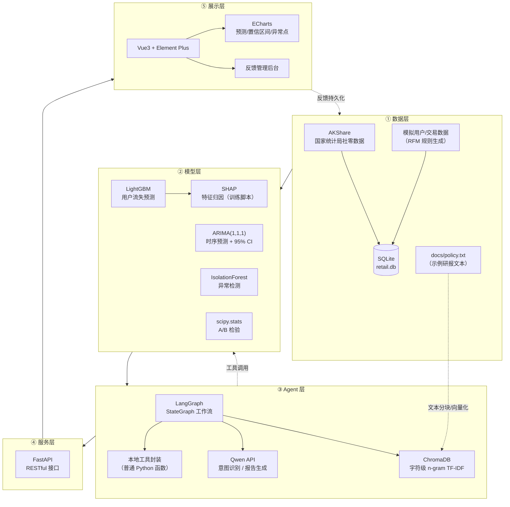

# Retail-Macro-Forecast-AI

### 零售消费品智能洞察中台 · Retail & Macro Intelligence Platform

一个从本科毕业论文研究思路演进而来的 Python + AI Agent 数据分析应用。

**演进路线：**

> **本科阶段**：R 语言零售消费数据分析与预测回测，重点验证预测效果
> → **后续扩展**：迁移至 Python 技术体系，扩展数据处理、机器学习与时间序列预测
> → **AI 应用**：RAG 知识检索、LangGraph 工作流编排、工具调用与结构化报告生成

系统融合：宏观数据分析、用户流失预测、时间序列预测、异常检测、RAG 知识检索、SQL 数据查询与 LangGraph Agent，实现从数据洞察到智能报告生成的完整流程。

<p align="center">
  
  
  
  
  
  
  
  
  
</p>

---

## 📖 目录

- [1. 项目简介](#1-项目简介)
- [2. 核心亮点](#2-核心亮点)
- [3. 系统架构](#3-系统架构)
- [4. 功能矩阵](#4-功能矩阵)
- [5. Agent 工具清单](#5-agent-工具清单)
- [6. 快速启动指南](#6-快速启动指南)
- [7. API 接口一览](#7-api-接口一览)
- [8. 项目结构](#8-项目结构)
- [9. 技术设计与实验结果](#9-技术设计与实验结果)
- [10. 当前限制与后续迭代方向](#10-当前限制与后续迭代方向)

---

## 1. 项目简介

### 1.1 本科毕业论文与当前项目的关系

本项目起源于本科毕业论文阶段对零售消费数据的研究。两者的关系是「研究思路延续、工程实现扩展」，而非同一套实验在不同语言下的简单复刻：

- **本科阶段（R 语言）**：使用 R 语言完成零售消费数据分析，并通过回测验证预测效果，重点在于验证「预测是否有效」这一研究问题。
- **当前项目（Python）**：在迁移至 Python 技术体系后，进一步扩展了机器学习流失预测、时间序列预测、异常检测、RAG 知识检索、LangGraph 工作流编排与 AI 报告生成等能力，定位为个人工程实践与作品集项目。

需要明确的是：

- 本科论文阶段并未实现当前项目的全部功能；当前项目是在其研究思路基础上的一次独立的工程化扩展。
- 本科论文的回测指标不应直接等同于当前 Python 项目的实验结果；本文档第 9 节所列指标均基于当前项目代码在当前数据快照上重新计算得出。
- 本项目为可运行、可演示的工程实践项目，未在任何企业生产环境中正式部署。

### 1.2 项目定位

**Retail-Macro-Forecast-AI** 是一个面向零售消费场景的数据智能演示平台，将「宏观研判」与「微观用户运营」组织到同一系统中：

- **宏观侧**：通过 AKShare 采集国家统计局「社会消费品零售总额」数据，用 ARIMA 做未来 3 个月预测，用 IsolationForest 识别异常月份。
- **微观侧**：基于 RFM 特征训练 LightGBM 用户流失预测模型，并在训练脚本中用 SHAP 计算特征归因。
- **智能侧**：以 LangGraph 编排 AI Agent，将模型与查询能力封装为本地工具，通过 Qwen 大模型完成意图识别与自然语言报告生成；内置基于 ChromaDB 的本地向量检索，支持政策/研报文本的 RAG 检索。
- **展示侧**：Vue3 + Element Plus + ECharts 打造数据看板，支持预测置信区间可视化、异常点标注、回测指标展示，以及 Agent 执行明细（SQL / RAG 原文）的可追溯展示。
- **闭环侧**：支持用户对 AI 报告点赞/点踩反馈，并配套「报告反馈管理」后台，进行分页查询、筛选与点赞率统计。

系统整体遵循「数据采集 → 特征工程 → 模型训练 → 服务化 → Agent 编排 → 可解释性 → 反馈闭环 → 可视化」的链路。

> **⚠️ 数据口径声明**：宏观社零数据来自公开统计源（国家统计局）；微观用户/交易数据为基于 RFM 规则生成的模拟数据，不代表真实企业客户；知识库 `docs/policy.txt` 为自撰的示例研报文本，并非真实企业政策文件。演示结果用于验证分析流程，不应直接作为真实经营决策依据。

---

## 2. 核心亮点

### 2.1 数据口径透明化
- 宏观数据来自国家统计局真实数据（AKShare 采集），时间范围 2008-01 至 2026-08。
- 微观用户/交易数据基于 RFM 规则模拟生成（生成阶段向约 30% 用户注入流失行为，最终流失标签占比约 16%）。
- 前端显式标注数据来源，区分「真实宏观数据」与「模拟用户数据」。

### 2.2 轻量 RAG（中文检索工程落地）
- 使用 ChromaDB 本地持久化向量库，无需重型 Embedding 模型。
- 针对中文场景采用**字符级 n-gram (2,3) TF-IDF** 分词方案，离线可用、无额外依赖。
- 对未命中场景明确返回「未在知识库中找到相关研报」，拒绝编造。

### 2.3 可解释性与防幻觉
- 通过 System Prompt 约束大模型输出三段式结构：【SQL查询结果】、【知识库引用】、【执行摘要】。
- 约束模型不得自行编造数据，缺失数据须输出「暂无数据」。
- 前端提供「查看执行明细」折叠面板，可追溯原始 SQL、数据量、ChromaDB 原文片段，增强过程透明度。

### 2.4 异常降级与状态透传
- 各工具与 API 均实现 `try/except` 降级，模型或依赖不可用时返回可读错误而非进程崩溃。
- 大模型调用失败时自动切换至模板兜底报告，并在前端标注「AI 服务降级」状态。
- 后端返回 `generation_status`（success / fallback / failed），如实反映生成状态。

### 2.5 反馈闭环
- AI 报告支持点赞/点踩反馈，反馈持久化至 SQLite，配套「报告反馈管理」后台（分页、筛选、点赞率统计）。

### 2.6 工程严谨性
- 数据库表采用 `CREATE TABLE IF NOT EXISTS` 幂等建表。
- 接口层提供统一异常处理与参数校验（非法参数 400、限流 429 等）。

---

## 3. 系统架构



---

## 4. 功能矩阵

| 功能模块 | 技术实现 | 关键输出 |
|---------|---------|---------|
| 宏观数据采集 | AKShare + SQLAlchemy | 2008-01 至 2026-08 月度社零数据 |
| 特征工程 | Pandas + 类别编码 | RFM 特征、城市等级 one-hot |
| 用户流失预测 | LightGBM + 类别不平衡处理 | 流失概率（训练脚本输出 AUC / KS / 分类报告） |
| 可解释性 | SHAP TreeExplainer | 特征归因（训练脚本内计算，未在 API/前端展示） |
| 时间序列预测 | statsmodels ARIMA(1,1,1) | 未来 3 个月预测 + 95% 置信区间 |
| 历史回测 | 最后 3 期留出评估 | MAE / RMSE / MAPE |
| 异常检测 | sklearn IsolationForest（contamination=0.05） | 异常月份标记 |
| A/B 测试 | scipy Levene + t 检验 | Uplift、显著性结论 |
| RAG 知识库 | ChromaDB + 字符级 n-gram | 文本检索、未命中明确提示 |
| AI Agent | LangGraph + 本地工具 + Qwen | 意图路由 + 结构化报告 + 执行明细 |
| 反馈闭环 | SQLite + FastAPI + Vue3 | 点赞/点踩持久化、点赞率统计、分页管理 |
| 前端看板 | Vue3 + Element Plus + ECharts | 预测置信区间图、异常散点、执行明细面板 |

---

## 5. Agent 工具清单

系统将数据查询、预测模型与知识检索能力封装为**本地 Agent 工具**（普通 Python 函数），供 LangGraph 工作流统一调用。

> **关于「MCP」的准确说明**：工具类命名为 `MCPToolServer`，但其实现是**在进程内直接调用的普通 Python 方法**，并未使用 MCP（Model Context Protocol）协议，也没有独立的 MCP Server / JSON-RPC 通信。命名上借鉴了 MCP 的「工具封装」思想，功能上等价于本地函数工具，请勿理解为本项目已接入 MCP 协议。

| 工具方法 | 能力 | 输入 | 输出 |
|---------|------|------|------|
| `query_macro_sqlite()` | 固定 SQL 查询宏观社零数据 | — | 最新 3 期社零额与同比增速 |
| `predict_churn_lightgbm()` | 用户流失预测（固定示例用户） | RFM + 城市等级特征 | 流失概率 |
| `forecast_timeseries()` | 时序预测 | — | 未来 3 个月预测 + 置信区间 + MAPE |
| `evaluate_ab_test(control, treatment)` | A/B 检验 | 两组样本 | Levene + t 检验 + Uplift 报告 |
| `rag_search(query)` | 知识库检索 | 自然语言问题 | 知识库原文片段 |

> 所有工具均实现**异常捕获与优雅降级**：模型或依赖不可用时返回可读的错误信息，而非进程崩溃，保障 Agent 主链路稳定。

---

## 6. 快速启动指南

### 6.1 环境准备

```bash
# 1. 创建并激活虚拟环境（推荐 Python 3.10）
conda create -n retail_env python=3.10 -y
conda activate retail_env

# 2. 安装后端依赖
pip install -r requirements.txt
```

### 6.2 生成数据与训练模型（首次运行）

仓库不提交数据、数据库与模型文件（均已在 `.gitignore` 中），首次运行需按顺序执行：

```bash
# 1. 采集宏观社零数据（写入 data/raw/*.csv 与 retail.db）
python src/data_pipeline/fetch_macro.py

# 2. 生成模拟用户/交易数据并构建流失数据集
python src/data_pipeline/generate_mock_data.py

# 3. 训练并保存 LightGBM 流失预测模型（保存至 src/models/saved_models/）
python src/models/train_lgbm_churn.py
```

执行完成后会生成 `retail.db`、`data/raw/`、`data/processed/`、`src/models/saved_models/lgbm_churn_model.pkl` 等运行时文件。

### 6.3 配置环境变量

在项目根目录创建 `.env`（已包含在 `.gitignore` 中，不会提交到仓库）：

```ini
DASHSCOPE_API_KEY=sk-xxxxxxxxxxxxxxxx
QWEN_MODEL=qwen3.7-flash
```

- `DASHSCOPE_API_KEY`：阿里云百炼（DashScope）API Key，必填。
- `QWEN_MODEL`：模型名，代码默认值为 `qwen3.7-flash`；仓库实际 `.env` 固定为快照版本 `qwen3.7-flash-2026-07-15`。
- 后端通过 OpenAI 兼容端点 `https://dashscope.aliyuncs.com/compatible-mode/v1` 调用 Qwen。

### 6.4 启动后端（FastAPI）

```bash
# 在项目根目录执行
uvicorn src.api.main:app --host 127.0.0.1 --port 8003 --reload
```

启动成功后访问：

- Swagger 文档：<http://127.0.0.1:8003/docs>
- 健康检查：<http://127.0.0.1:8003/health>

### 6.5 启动前端（Vue3）

```bash
cd retail-frontend
npm install          # 首次运行
npm run dev          # 开发模式，默认 http://localhost:5173
```

打开浏览器访问前端页面，可查看「数据总览」、「用户流失预警」、「智能问数 Agent」与「报告反馈管理」四大模块。

---

## 7. API 接口一览

| 方法 | 路径 | 说明 |
|------|------|------|
| `GET` | `/` | 服务欢迎信息 |
| `GET` | `/health` | 健康检查 |
| `POST` | `/api/v1/analyze` | 自然语言问数（AI Agent 诊断报告，限流 5 次/分钟/IP） |
| `GET` | `/api/v1/forecast` | 社零总额 ARIMA 预测（供前端 ECharts 使用） |
| `POST` | `/api/v1/feedback` | 提交用户反馈（up/down），持久化至 SQLite |
| `GET` | `/api/v1/feedback` | 分页查询反馈记录（支持筛选） |
| `GET` | `/api/v1/feedback/stats` | 反馈统计（总数/点赞/点踩/点赞率） |

`/api/v1/forecast` 响应示例（节选）：

```json
{
  "historical_dates": ["2008-01", "2008-02", "..."],
  "historical_values": [9077.3, 8354.7, "..."],
  "forecast_dates": ["2026-09", "2026-10", "2026-11"],
  "forecast_values": [40233.6, 40448.8, 40562.0],
  "lower_bound": [35956.6, 35213.0, 34819.2],
  "upper_bound": [44510.6, 45684.7, 46304.9],
  "metrics": { "mae": 1752.75, "rmse": 1792.03, "mape": 4.36 },
  "anomalies": [
    { "date": "2020-03", "value": 26449.9 },
    { "date": "2022-04", "value": 29483.1 },
    "... 共 10 个异常月份（此处节选 2 个）"
  ]
}
```

> 上述数值为当前数据快照下、`ARIMA(1,1,1)` 以最后 3 个月作为留出回测窗口计算得到的结果；不同数据快照下数值会变化，见第 9 节。

`/api/v1/feedback/stats` 响应示例：

```json
{
  "status": "ok",
  "message": "查询成功",
  "data": { "total": 3, "up_count": 2, "down_count": 1, "up_rate": 0.6667 }
}
```

---

## 8. 项目结构

```
retail_insight_platform/
├── src/
│   ├── data_pipeline/              # 数据采集与模拟数据生成
│   │   ├── fetch_macro.py          # AKShare 采集宏观社零数据
│   │   └── generate_mock_data.py   # 模拟用户/交易数据 + RFM 特征 + 流失标签
│   ├── models/                     # 模型训练与推理
│   │   ├── train_lgbm_churn.py     # LightGBM 流失预测 + SHAP
│   │   └── train_timeseries.py     # ARIMA 预测 + 异常检测 + 回测
│   ├── agents/                     # AI Agent 编排
│   │   ├── tools.py                # 本地工具封装（类名 MCPToolServer，非 MCP 协议）
│   │   └── graph_workflow.py       # LangGraph 工作流
│   └── api/
│       └── main.py                 # FastAPI 接口
├── docs/
│   └── policy.txt                  # RAG 知识库示例研报文本
├── retail-frontend/                # Vue3 前端
│   └── src/App.vue                 # 数据总览 / 流失预警 / 智能问数 / 反馈管理
├── requirements.txt
└── .env                            # 环境变量（不入库）
```

以下目录/文件为**运行脚本后生成**，不提交到 Git（已在 `.gitignore` 中）：

```
retail_insight_platform/
├── data/                           # 采集与生成的 CSV 数据
│   ├── raw/                        # macro_retail_sales.csv / transactions.csv / users_info.csv
│   └── processed/                  # churn_dataset.csv
├── src/models/saved_models/        # 训练好的 LightGBM 模型（lgbm_churn_model.pkl）
├── retail.db                       # SQLite 数据库
└── chroma_db/                      # ChromaDB 向量库（首次 RAG 检索时生成）
```

---

## 9. 技术设计与实验结果

> 本节聚焦「实际问题 → 技术选择 → 验证方法 → 当前局限」。除特别说明外，指标均在当前数据快照（宏观数据截至 2026-08）下、按代码默认参数重新计算得到。

### 9.1 时序预测与回测的实验条件

- **实际问题**：社零总额呈明显上涨趋势与季节性，直接预测易被趋势主导。
- **技术选择**：采用 `statsmodels` ARIMA(1,1,1)，以最后 3 个月作为留出回测窗口（用前 N-3 期训练、预测最后 3 期并与真实值对比）。
- **验证结果**（当前快照下复现）：

| 指标 | 数值 | 计算口径 |
|------|------|---------|
| MAE | 1752.75 亿元 | 留出 3 期预测值与真实值的平均绝对误差 |
| RMSE | 1792.03 亿元 | 留出 3 期的均方根误差 |
| MAPE | 4.36% | 留出 3 期的平均绝对百分比误差 |

- **当前局限**：回测仅覆盖 3 期留出窗口，样本量小，指标对数据快照与划分方式敏感；需在固定条件下复现后再用于对外汇报。

### 9.2 特征选择：为什么用「同比增长率」做异常检测

- **实际问题**：直接对 18 年社零原始值做异常检测，会被长期上涨趋势主导，容易把 2008~2009 年低基数期误判为异常。
- **技术选择**：改用 `yoy_growth`（同比增速）作为检测特征。同比是同月对比，可消除趋势与季节性，将检测聚焦在「偏离正常增速」上。
- **验证结果**：IsolationForest（`contamination=0.05`、`random_state=42`、特征 `yoy_growth`）共标记 10 个异常月份，包括 2020-03/04/05（疫情）、2022-03/04/05/11（封控）与 2008-06/07（金融危机期间）等；另有 2021-03 等月份，其异常归属建议结合宏观事件人工复核，不直接等同于「精准命中」。
- **当前局限**：`contamination` 为人工设定的比例参数（5%），异常数量随该参数变化；缺乏真实异常标签，无法给出可验证的「误判率」类指标。

### 9.3 成本权衡：ARIMA vs 复杂模型

| 维度 | ARIMA(1,1,1) | LSTM / Prophet |
|------|-------------|----------------|
| 训练成本 | 毫秒级，单机即可 | 需要 GPU / 较长时间 |
| 可解释性 | 参数透明，置信区间解析解 | 黑盒，区间需近似 |
| 数据需求 | 数十个样本即可 | 需要大量样本 |
| 适用场景 | 宏观月度数据、少样本 | 高频、复杂非线性 |

### 9.4 RAG 工程落地：轻量中文检索方案

- **问题 1**：`TfidfVectorizer` 默认按空格分词，对中文无效（相似度全为 0）。
- **决策 1**：采用**字符级 n-gram (2,3)**，无需引入 `jieba` 等额外依赖，离线可用。
- **问题 2**：语料/分词变化会导致 ChromaDB 向量维度不一致。
- **决策 2**：每次调用采用「先删后建」写入集合，规避维度冲突。
- **当前局限**：字符级 TF-IDF 非稠密语义 Embedding，对同义改写与复杂语义的召回能力有限；每次重建集合适合小规模演示，不适合大语料高并发。

### 9.5 用户流失预测的实验条件

- **技术选择**：基于 RFM 特征与城市等级 one-hot 特征训练 LightGBM，使用 `scale_pos_weight` 处理类别不平衡。
- **验证结果**：模拟数据流失标签占比约 15.95%；训练脚本在 `random_state=42` 的 20% 测试集上评估（AUC 约 0.82、KS 约 0.56）。这些指标由训练脚本打印输出，未通过 API 或前端动态展示。
- **当前局限**：流失标签为规则生成（非真实业务流失），模型在默认 0.5 阈值下分类 F1≈0（模型偏向概率排序而非硬分类），实际落地需结合业务做阈值调优；前端「用户流失预警」页与「智能问数」中的流失预测工具使用固定示例用户/静态演示数据，未接入真实批量推理接口。

### 9.6 优雅降级：AI 系统的稳定性保障

所有工具与 API 均实现 `try/except` 降级。当大模型 API、模型文件或数据库不可用时，系统返回可读的降级信息，保证主链路不因单点故障而崩溃；报告生成失败时回退至模板兜底报告，并在响应中通过 `generation_status` / `fallback_reason` 如实标注。

### 9.7 从「模型」到「行动」

系统将模型能力封装为本地工具，由 LangGraph 工作流按「意图识别 → 规则路由 → 工具调用 → 报告生成」组织执行。前端提供「查看执行明细」面板，可追溯 SQL 语句与 RAG 原文。用户反馈闭环（点赞/点踩 + 管理后台）为后续 Prompt 迭代提供数据支撑。

---

## 10. 当前限制与后续迭代方向

本项目定位为可运行、可演示的 AI 应用作品，不等同于已通过生产验收的企业系统。以下边界应如实说明：

- **MCP / 工具封装**：当前为进程内普通 Python 函数封装，未接入 MCP 协议；如需标准化工具协议，可后续迁移至 MCP SDK 或独立工具服务。
- **SQL 查询**：宏观数据查询为代码中固定的业务 SQL，并非 Text-to-SQL（自然语言自动生成 SQL）。
- **多模态识图**：前端支持上传图片并转为 Base64 传输，但后端对图片的处理为**预留接口**（当前返回固定占位文本），未接入真实视觉模型。
- **RAG**：使用字符级 TF-IDF，而非稠密语义 Embedding；对同义改写和复杂语义的召回能力有限。
- **向量库**：每次调用都重建 ChromaDB 集合，适合小规模演示，不适合大语料高并发；生产环境应将文档解析、向量化与入库作为独立的离线/增量任务。
- **反馈闭环**：已实现反馈持久化落库与管理页查询；但「批量召回计划」仍为前端交互演示，未在真实后端创建任务或向用户发送营销信息。
- **用户流失预警**：前端流失预警表格与 KPI 卡片为静态演示数据，未接入真实批量推理接口。
- **报告导出**：使用浏览器 `window.print()`，不是由服务端生成和存档 PDF。
- **限流**：单机内存限流（5 次/分钟/IP）不适合多实例生产环境，后续应迁移到 Redis 等共享存储。
- **数据依赖性**：预测误差和异常识别效果依赖数据快照、训练/测试划分、参数和评估方法；需在固定条件下复现实验后再用于对外汇报。
- **访问控制**：当前演示后台未包含完整的生产级认证、授权与审计机制，对外部署前需补充。
