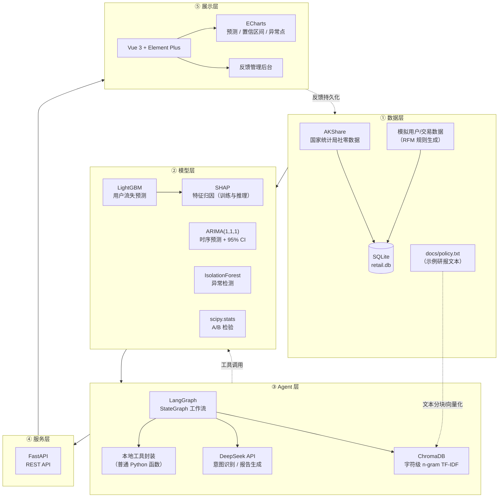
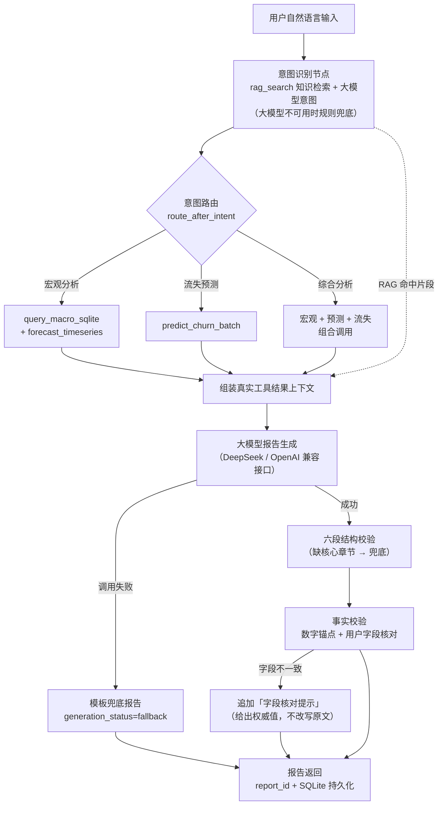

# AI Retail Analyst · 智能经营分析助手

### 零售消费品智能洞察中台 · Retail & Macro Intelligence Platform

一个面向零售消费场景的 Python + AI Agent 数据分析应用，融合宏观经济数据分析、用户流失预测、时间序列预测、异常检测、知识检索与智能报告生成。

**项目演进路线：**

> **研究背景**：此前使用 R 语言开展《中国社会消费品零售总额确定性影响因素与预测研究》，进行社零数据分析与时间序列预测。  
> → **Python 工程实践**：围绕宏观数据分析，扩展用户流失预测、时间序列预测、异常检测等能力。  
> → **AI 应用开发**：引入 RAG 知识检索、LangGraph 工作流编排、工具调用与结构化报告生成，整合数据分析、模型推理与智能报告生成能力。

系统整体遵循「数据采集 → 特征工程 → 模型训练 → 服务化 → Agent 编排 → 可解释性 → 反馈闭环 → 可视化」的处理链路。

<p align="center">
  
  
  
  
  
  
  
  
  
</p>

---

## 📖 目录

- [1. 项目简介](#1-项目简介)
- [2. 核心亮点](#2-核心亮点)
- [3. 系统架构](#3-系统架构)
- [4. 功能矩阵](#4-功能矩阵)
- [5. Agent 工具清单](#5-agent-工具清单)
- [6. 快速启动指南](#6-快速启动指南)
- [7. API 接口一览](#7-api-接口一览)
- [8. 项目结构](#8-项目结构)
- [9. 技术设计与实验结果](#9-技术设计与实验结果)
- [10. 当前限制与后续迭代方向](#10-当前限制与后续迭代方向)

---

## 1. 项目简介

### 1.1 研究背景与项目演进

本项目的研究背景来自此前使用 R 语言开展的《中国社会消费品零售总额确定性影响因素与预测研究》。在此基础上，我使用 Python 重新构建数据处理与预测分析流程，并逐步扩展机器学习、异常检测、RAG 知识检索和 AI Agent 等功能。

当前项目的重点不只是预测模型本身，而是将数据采集、模型推理、智能工具调用、工作流编排、报告生成与前端可视化整合为一个可运行、可演示的数据分析应用。

需要说明的是，原有 R 语言研究与当前 Python 项目属于研究思路的延续和工程能力的扩展，并非同一套代码的简单迁移。本文档中的实验指标均以当前 Python 项目的代码、数据快照和评估口径为准。

本项目定位为个人工程实践与作品集项目，尚未在企业生产环境中正式部署。

### 1.2 项目定位

**AI Retail Analyst** 是一个面向零售消费场景的数据智能演示平台，将宏观研判与微观用户运营组织到同一系统中：

- **宏观侧**：通过 AKShare 获取国家统计局社会消费品零售总额数据，使用 ARIMA 预测未来 3 个月走势，并通过 IsolationForest 识别异常月份。
- **微观侧**：基于 RFM 特征训练 LightGBM 用户流失预测模型，并通过 SHAP 分析特征对模型预测的贡献。
- **智能侧**：以 LangGraph 编排 AI Agent，将模型与查询能力封装为本地工具，通过 DeepSeek 大模型完成意图识别与自然语言报告生成；内置基于 ChromaDB 的本地知识检索能力，支持对政策与研报示例文本进行 RAG 检索。
- **展示侧**：使用 Vue 3、Element Plus 与 ECharts 构建数据看板，展示预测结果、置信区间、异常点、回测指标，以及 Agent 执行明细（SQL、RAG 原文等）。
- **反馈侧**：支持 AI 报告点赞与点踩，反馈数据持久化至 SQLite，并通过管理后台进行分页查询、条件筛选与点赞率统计。

> **数据口径声明**：宏观社零数据来自公开统计源（国家统计局）；微观用户与交易数据为基于 RFM 规则生成的模拟数据，不代表真实企业客户；知识库 `docs/policy.txt` 为自撰的示例研报文本，并非真实企业政策文件。演示结果用于验证分析流程，不应直接作为真实经营决策依据。

---

## 2. 核心亮点

### 2.1 数据口径透明化

- 宏观数据通过 AKShare 采集，当前文档对应的数据快照时间范围为 2008-01 至 2026-08。
- 微观用户与交易数据基于 RFM 规则模拟生成，生成阶段向约 30% 用户注入流失行为，最终流失标签占比约 16%。
- 前端显式标注数据来源，区分真实宏观数据与模拟用户数据。

### 2.2 轻量 RAG（中文检索工程落地）

- 使用 ChromaDB 本地持久化向量库。
- 针对中文场景采用**字符级 n-gram（2、3）TF-IDF** 表示文本，无需额外依赖中文分词器或稠密 Embedding 模型。
- 对未命中场景明确返回“未在知识库中找到相关研报”，避免在没有检索依据时编造知识库内容。

### 2.3 可解释性与防幻觉

- 通过 System Prompt 约束大模型输出六段式结构：【核心结论】、【数据依据】、【趋势与预测分析】、【异常与风险】、【建议的下一步分析】、【结果限制与不确定性】。
- 约束模型依据工具实际返回的数据作答，缺失数据须输出“暂无数据”，不允许将模型自行推断的数值伪装成真实查询结果。
- 在数字锚点覆盖检查之外，对报告中的高危用户字段（城市等级、年龄、流失概率）做**字段级覆盖核对**：按稳定用户 ID 与工具返回的结构化结果逐字段比对，发现不一致时在报告末尾追加“字段核对提示”并给出权威值。该核对明确标注为“非完整事实核验”，只覆盖工具结果有权威值的字段。
- 前端提供“执行明细”面板，可追溯意图识别结果、实际调用的工具、原始 SQL、ChromaDB 原文片段与来源，以及报告是由大模型生成还是由模板降级生成。

### 2.4 异常降级与状态透传

- 工具与 API 对常见异常进行捕获和处理，模型或依赖不可用时尽量返回可读错误信息，而非直接导致进程崩溃。
- 大模型调用失败时自动切换至模板兜底报告，并在前端标注“AI 服务降级”状态。
- 后端通过 `generation_status`（`success` / `fallback` / `failed`）返回生成状态。

### 2.5 反馈闭环

- AI 报告支持点赞与点踩反馈，反馈数据持久化至 SQLite。
- 提供“报告反馈管理”后台，支持分页、筛选及点赞率统计，为后续 Prompt 调整提供参考。

### 2.6 工程严谨性

- 数据库表采用 `CREATE TABLE IF NOT EXISTS`，支持幂等建表。
- 接口层提供参数校验与统一异常处理；非法参数返回 400，触发限流时返回 429。
- 每次分析报告都会生成唯一 `report_id` 并持久化至 SQLite 的 `analysis_reports` 表（`report_store.py`）；持久化失败不影响报告返回，接口通过 `report_persisted` 字段如实标注保存结果。
- 内置一套**无副作用离线评测框架**（`src/evaluation/` + `evals/`）：在不调用真实大模型、不接入 LangSmith、不写真实数据库的前提下，用确定性 gate 与轨迹校验评估 Agent 输出，并对 trace 做字段白名单、脱敏与原子落盘（详见 `docs/evaluation.md`）。

---

## 3. 系统架构



### 3.1 核心业务流程（按实际调用链）



---

## 4. 功能矩阵

| 功能模块 | 技术实现 | 关键输出 |
|---|---|---|
| 宏观数据采集 | AKShare + SQLAlchemy | 2008-01 至 2026-08 月度社零数据（以当前数据快照为准） |
| 特征工程 | Pandas + 类别编码 | RFM 特征、城市等级 one-hot 特征 |
| 用户流失预测 | LightGBM + 类别不平衡处理 | 批量流失概率、风险分布与高风险用户（真实模型推理接口，输入数据为模拟数据） |
| 可解释性 | SHAP TreeExplainer | 特征归因（推理接口可返回，前端图表展示） |
| 时间序列预测 | statsmodels ARIMA(1,1,1) | 未来 3 个月预测与 95% 置信区间 |
| 历史回测 | 最后 3 期留出评估 | MAE / RMSE / MAPE |
| 异常检测 | sklearn IsolationForest（`contamination=0.05`） | 异常月份标记 |
| A/B 测试 | scipy Levene + t 检验 | Uplift、显著性检验结果 |
| RAG 知识库 | ChromaDB + 字符级 n-gram TF-IDF | 文本检索、未命中提示 |
| AI Agent | LangGraph + 本地工具 + DeepSeek | 意图路由、结构化报告、执行明细 |
| 反馈闭环 | SQLite + FastAPI + Vue 3 | 点赞/点踩持久化、点赞率统计、分页管理 |
| 前端看板 | Vue 3 + Element Plus + ECharts | 预测置信区间图、异常散点、执行明细面板 |

---

## 5. Agent 工具清单

系统将数据查询、预测模型与知识检索能力封装为**本地 Agent 工具**（普通 Python 函数），供 LangGraph 工作流统一调用。

> **关于 MCP 的准确说明**：工具类命名为 `MCPToolServer`，但其实现是在进程内直接调用的普通 Python 方法，并未使用 MCP（Model Context Protocol）协议，也没有独立的 MCP Server 或 JSON-RPC 通信。命名上借鉴了工具封装的思路，不代表本项目已接入 MCP 协议。

| 工具方法 | 能力 | 输入 | 输出 |
|---|---|---|---|
| `query_macro_sqlite()` | SQL 查询宏观社零数据 | `limit`（默认 12） | 最近 N 期社零额与同比增速、趋势摘要 |
| `forecast_timeseries()` | ARIMA 时序预测与异常检测 | 无 | 未来 3 个月预测、置信区间、回测 MAPE、异常月份 |
| `predict_churn_batch()` | 用户流失批量推理（真实模型） | `top_n` | 风险分布、高风险用户、SHAP 特征归因 |
| `predict_churn_lightgbm()` | 单用户流失预测（示例） | RFM + 城市等级特征 | 流失概率 |
| `evaluate_ab_test(control, treatment)` | A/B 检验 | 两组样本 | Levene 检验、t 检验与 Uplift 报告 |
| `rag_search(query)` | 知识库检索 | 自然语言问题 | 知识库原文片段与来源 |

工作流按意图路由调用工具：

- **宏观分析**：调用 `query_macro_sqlite` 与 `forecast_timeseries`。
- **流失预测**：调用 `predict_churn_batch`。
- **综合分析**：组合调用宏观查询、预测及流失分析工具。
- `evaluate_ab_test` 当前可独立使用，但尚未接入主工作流。
- `rag_search` 提供知识库检索能力；是否在一次分析中执行取决于工作流路由。

所有工具均包含异常捕获与降级处理。模型或依赖不可用时，工具尽量返回可读的错误信息，而非让 Agent 主链路直接崩溃。每次工具调用都会写入统一执行记录，包括工具名、输入、状态、耗时、错误信息与摘要，供前端执行明细面板展示。

---

## 6. 快速启动指南

### 6.1 环境准备

推荐使用 Python 3.10，并通过 Conda 创建独立环境：

```bash
conda create -n retail_env python=3.10 -y
conda activate retail_env
pip install -r requirements.txt
```

### 6.2 生成数据与训练模型（首次运行）

仓库不提交数据、数据库与模型文件（均配置在 `.gitignore` 中）。首次运行时，按顺序执行：

```bash
# 1. 采集宏观社零数据（写入 data/raw/*.csv 与 retail.db）
python src/data_pipeline/fetch_macro.py

# 2. 生成模拟用户/交易数据并构建流失数据集
python src/data_pipeline/generate_mock_data.py

# 3. 训练并保存 LightGBM 流失预测模型
python src/models/train_lgbm_churn.py
```

执行完成后会生成 `retail.db`、`data/raw/`、`data/processed/`、`src/models/saved_models/lgbm_churn_model.pkl` 等运行时文件。

### 6.3 配置环境变量

仓库提供了 `.env.example` 作为模板，可复制为项目根目录下的 `.env` 后填入真实值（`.env` 已加入 `.gitignore`，不应提交 API Key）：

```ini
# DeepSeek 大模型配置（OpenAI 兼容接口）
DEEPSEEK_API_KEY=sk-xxxxxxxxxxxxxxxx
DEEPSEEK_BASE_URL=https://api.deepseek.com
DEEPSEEK_MODEL=deepseek-chat

# 可选：LangSmith 追踪（默认关闭；开启后需填入有效 LANGSMITH_API_KEY）
LANGSMITH_TRACING=false
LANGSMITH_API_KEY=
LANGSMITH_PROJECT=retail-macro-forecast-ai
```

- `DEEPSEEK_API_KEY`：DeepSeek 开放平台 API Key。**未配置或鉴权失败时，Agent 会自动降级为模板兜底报告**，此时 `generation_status` 返回 `fallback`；兜底报告只汇总真实工具结果，不替代大模型的语义归纳能力。
- `DEEPSEEK_BASE_URL`：OpenAI 兼容端点地址，代码默认值为 `https://api.deepseek.com`。
- `DEEPSEEK_MODEL`：指定调用的模型名称，代码默认值为 `deepseek-chat`；具体可用模型名称以 DeepSeek 开放平台为准（例如 `deepseek-chat`、`deepseek-reasoner` 等）。
- `LANGSMITH_TRACING` / `LANGSMITH_API_KEY` / `LANGSMITH_PROJECT`：可选，默认关闭；仅用于把大模型调用接入 LangSmith 追踪，不开启不影响功能。
- 后端通过 OpenAI Python SDK 兼容接口调用 DeepSeek，无需更换 SDK。

请根据当前账号权限和可用模型配置填写真实 API Key。不要将包含密钥的 `.env` 文件提交到公开仓库。

### 6.4 启动后端（FastAPI）

在项目根目录执行：

```bash
uvicorn src.api.main:app --host 127.0.0.1 --port 8003 --reload
```

启动后可访问：

- Swagger 文档：<http://127.0.0.1:8003/docs>
- 健康检查：<http://127.0.0.1:8003/health>

### 6.5 启动前端（Vue 3）

```bash
cd retail-frontend
npm install
npm run dev
```

开发服务器默认地址为 <http://localhost:5173>。打开页面后，可查看“数据总览”“用户流失预警”“智能问数 Agent”与“报告反馈管理”等模块。

### 6.6 运行测试

在项目根目录、已激活 `retail_env` 环境的情况下执行：

```bash
python -m unittest discover -s src/tests -v
```

当前后端全量测试为 **106 项，全部通过**（随代码演进可能变化，以实际运行为准）。测试覆盖意图路由、工具执行、报告降级、六段式解析、数字锚点与用户字段事实校验、LangGraph 路由与执行追踪、FastAPI 集成接口（`/forecast`、`/churn/predict`、`/churn/recall`、`/analyze`、`/overview` 等）、报告持久化，以及离线评测基础设施。测试通过将 `graph_workflow.client` 置空强制走规则降级与模板兜底，不依赖外部大模型 API。

### 6.7 构建前端

```bash
cd retail-frontend
npm run build
```

构建产物输出至 `retail-frontend/dist/`（当前实测构建通过）。

### 6.8 无副作用离线评测（可选）

不调用真实大模型、不接入 LangSmith、不写真实数据库，通过确定性 gate 与轨迹校验评估 Agent 输出：

```bash
PYTHONPATH=. python -m src.evaluation.cli --cases evals/cases --traces evals/traces
```

更多细节见 [`docs/evaluation.md`](docs/evaluation.md)。

---

## 7. API 接口一览

| 方法 | 路径 | 说明 |
|---|---|---|
| `GET` | `/` | 服务欢迎信息 |
| `GET` | `/health` | 健康检查 |
| `POST` | `/api/v1/analyze` | 自然语言问数：意图路由、工具调用、六段式报告、执行追踪与图表数据；限流 5 次/分钟/IP |
| `GET` | `/api/v1/forecast` | 社零总额 ARIMA 预测，供前端 ECharts 使用 |
| `GET` | `/api/v1/churn/predict` | 用户流失批量推理：风险分布、高风险用户与 SHAP 特征归因 |
| `POST` | `/api/v1/churn/recall` | 创建批量召回任务，持久化至 `recall_tasks` 表 |
| `GET` | `/api/v1/overview` | 返回最新社零数据、流失标签占比与回测指标等总览数据 |
| `POST` | `/api/v1/feedback` | 提交点赞/点踩反馈并持久化至 SQLite |
| `GET` | `/api/v1/feedback` | 分页查询反馈记录，支持筛选 |
| `GET` | `/api/v1/feedback/stats` | 查询反馈总数、点赞数、点踩数与点赞率 |

### `/api/v1/forecast` 响应示例（节选）

```json
{
  "historical_dates": ["2008-01", "2008-02", "..."],
  "historical_values": [9077.3, 8354.7, "..."],
  "forecast_dates": ["2026-09", "2026-10", "2026-11"],
  "forecast_values": [40233.6, 40448.8, 40562.0],
  "lower_bound": [35956.6, 35213.0, 34819.2],
  "upper_bound": [44510.6, 45684.7, 46304.9],
  "metrics": {
    "mae": 1752.75,
    "rmse": 1792.03,
    "mape": 4.36
  },
  "anomalies": [
    {"date": "2020-03", "value": 26449.9},
    {"date": "2022-04", "value": 29483.1},
    "... 共 10 个异常月份（此处节选 2 个）"
  ]
}
```

以上数值为原始开发数据快照下，ARIMA(1,1,1) 以最后 3 个月作为留出回测窗口得到的示例结果。数据更新或实验配置变化后，结果可能发生变化；对外展示前应在当前环境中重新运行并核验。

### `/api/v1/analyze` 响应示例（节选）

```json
{
  "report": "===== 零售业务智能洞察报告 =====\n\n【核心结论】…\n【数据依据】…",
  "intent": "综合分析",
  "intent_reason": "大模型识别",
  "generation_status": "success",
  "fallback_reason": "",
  "sections": [
    {"title": "【核心结论】", "content": "…"},
    {"title": "【数据依据】", "content": "…"}
  ],
  "execution": [
    {
      "name": "intent_recognition",
      "status": "success",
      "summary": "识别意图为「综合分析」",
      "duration_ms": 812.3
    },
    {
      "name": "query_macro_sqlite",
      "status": "success",
      "sql": "SELECT date, …",
      "duration_ms": 1.5
    },
    {
      "name": "forecast_timeseries",
      "status": "success",
      "summary": "回测 MAPE=4.36%",
      "duration_ms": 210.4
    },
    {
      "name": "predict_churn_batch",
      "status": "success",
      "summary": "共对 4766 名模拟用户执行流失预测",
      "duration_ms": 1348.0
    },
    {
      "name": "report_generation",
      "status": "success",
      "summary": "大模型生成报告"
    }
  ],
  "data": {
    "macro": [{"date": "2026-08", "value": 39824.4, "yoy": 0.4}],
    "forecast": {"historical_dates": [], "forecast_values": [], "anomalies": []},
    "churn": {"risk_distribution": [], "feature_importance": [], "top_risk_users": []}
  }
}
```

### `/api/v1/feedback/stats` 响应示例

```json
{
  "status": "ok",
  "message": "查询成功",
  "data": {
    "total": 3,
    "up_count": 2,
    "down_count": 1,
    "up_rate": 0.6667
  }
}
```

---

## 8. 项目结构

```text
retail_insight_platform/
├── src/
│   ├── data_pipeline/               # 数据采集与模拟数据生成
│   │   ├── fetch_macro.py           # AKShare 采集宏观社零数据（写入 CSV 与 SQLite）
│   │   └── generate_mock_data.py    # 模拟用户/交易数据、RFM 特征与流失标签
│   ├── models/                      # 模型训练与推理
│   │   ├── train_lgbm_churn.py      # LightGBM 流失预测训练与评估（AUC/KS/F1/SHAP）
│   │   ├── churn_inference.py       # LightGBM 批量推理与 SHAP 归因
│   │   └── train_timeseries.py      # ARIMA 预测、异常检测与回测
│   ├── agents/                      # AI Agent 编排
│   │   ├── tools.py                 # 本地工具封装（MCPToolServer 类名，非 MCP 协议）
│   │   ├── graph_workflow.py        # LangGraph 工作流、报告生成与事实校验
│   │   └── report_store.py          # 分析报告持久化（report_id + SQLite）
│   ├── evaluation/                  # 无副作用离线评测框架
│   │   ├── cli.py                   # 离线评测 CLI 入口
│   │   ├── runner.py                # OfflineBenchmarkRunner（串行执行 + 字段白名单）
│   │   ├── gates.py                 # 四个确定性 gate
│   │   ├── trajectory.py            # 节点路径 / 工具序列校验
│   │   ├── callbacks.py             # LangGraph 事件采集回调
│   │   ├── privacy.py               # 脱敏 + 截断 + SHA-256 指纹
│   │   └── trace_writer.py          # 原子写 JSON trace
│   ├── tests/                       # 单元与集成测试
│   │   ├── test_agent.py            # 工具、意图、兜底与报告解析
│   │   ├── test_workflow.py         # LangGraph 路由、真实工具与报告降级
│   │   ├── test_api.py              # FastAPI 集成测试
│   │   ├── test_fact_check.py       # 数字锚点 + 用户字段事实校验
│   │   ├── test_macro_nan.py        # 宏观 NaN/Inf 回归
│   │   ├── test_overview.py         # overview 接口无效数据健壮性
│   │   ├── test_timeseries.py       # 时间序列回测与数据泄漏防护
│   │   ├── test_suggestions.py      # 结构化行动建议解析
│   │   ├── test_report_store.py     # 报告持久化
│   │   ├── test_config.py           # DeepSeek 配置与降级提示
│   │   └── test_evaluation.py       # 离线评测基础设施
│   └── api/
│       └── main.py                  # FastAPI 接口
├── docs/
│   ├── policy.txt                   # RAG 知识库示例研报文本
│   └── evaluation.md                # 离线评测框架说明
├── evals/
│   └── cases/                       # 离线评测案例（JSON：macro / churn / comprehensive）
├── retail-frontend/                 # Vue 3 前端
│   └── src/App.vue                  # 数据总览、流失预警、智能问数、反馈管理
├── requirements.txt
├── .env.example                     # 环境变量模板（复制为 .env 后填入真实值）
└── .gitignore
```

以下目录或文件为运行脚本后生成，不提交到 Git（已配置在 `.gitignore` 中）：

```text
retail_insight_platform/
├── data/                             # 采集与生成的 CSV 数据
│   ├── raw/                          # macro_retail_sales.csv / transactions.csv / users_info.csv
│   └── processed/                    # churn_dataset.csv
├── src/models/saved_models/          # 训练好的 LightGBM 模型文件
├── retail.db                         # SQLite 数据库
└── chroma_db/                        # ChromaDB 本地向量库
```

---

## 9. 技术设计与实验结果

本节聚焦“实际问题 → 技术选择 → 验证方法 → 当前局限”。除特别说明外，以下结果对应开发时使用的数据快照（宏观数据截至 2026-08）和代码默认参数。重新采集数据、调整代码或改变实验划分后，指标可能变化。

### 9.1 时序预测与回测的实验条件

- **实际问题**：社零总额具有长期趋势和季节性，直接预测容易受到趋势影响。
- **技术选择**：采用 `statsmodels` 的 ARIMA(1,1,1)，以最后 3 个月作为留出回测窗口，用此前数据拟合模型后预测这 3 期，并与实际值对比。
- **验证结果**（当前开发快照下的记录）：

| 指标 | 数值 | 计算口径 |
|---|---:|---|
| MAE | 1752.75 亿元 | 留出 3 期预测值与实际值的平均绝对误差 |
| RMSE | 1792.03 亿元 | 留出 3 期的均方根误差 |
| MAPE | 4.36% | 留出 3 期的平均绝对百分比误差 |

- **当前局限**：回测只覆盖 3 期，样本量较小，指标对数据快照与划分方式敏感；对外汇报前应在固定条件下重新复现。

### 9.2 特征选择：为什么用同比增长率做异常检测

- **实际问题**：直接对多年社零原始值进行异常检测，可能被长期上涨趋势主导，导致模型将早期低基数时期识别为异常。
- **技术选择**：使用 `yoy_growth`（同比增速）作为检测特征。同比以相同月份进行比较，有助于减弱趋势和季节性影响，使检测更聚焦于增速偏离。
- **验证结果**：IsolationForest 使用 `contamination=0.05`、`random_state=42`，基于 `yoy_growth` 标记了 10 个异常月份。开发时的记录包括 2020-03/04/05、2022-03/04/05/11 和 2008-06/07 等月份；异常归属仍需结合宏观事件人工复核，不应直接视为精准命中。
- **当前局限**：`contamination` 是人为设置的比例参数，异常数量会随参数变化；由于缺少真实异常标签，目前无法计算可验证的误判率或召回率。

### 9.3 成本权衡：ARIMA 与复杂模型

| 维度 | ARIMA(1,1,1) | LSTM / Prophet |
|---|---|---|
| 训练与运行成本 | 当前任务下计算开销较低，普通 CPU 可运行 | 取决于模型配置、数据量与训练方式，通常有更高的调参成本 |
| 可解释性 | 统计建模假设和参数相对明确 | 解释复杂度通常更高 |
| 数据需求 | 可用于中小规模单变量时间序列，但效果依赖序列特性 | 对数据量、特征质量和调参更敏感，具体取决于方法 |
| 适用场景 | 可作为宏观月度数据的基线模型 | 可在存在足够数据、复杂模式或额外特征时进行对比实验 |

本项目使用 ARIMA 主要是为了构建轻量、可运行的预测示例，并不意味着它在所有场景下都优于其他时间序列模型。

### 9.4 RAG 工程落地：轻量中文检索方案

- **问题 1**：`TfidfVectorizer` 默认按空格切分词语，直接用于中文文本时，可能无法形成理想的词项表示，导致检索效果不佳。
- **决策 1**：采用字符级 n-gram（2、3），不依赖额外中文分词器，可离线运行。
- **问题 2**：如果语料、向量化配置或特征维度发生变化，旧集合中的向量可能无法与新向量兼容。
- **决策 2**：当前实现采用先删除再重建集合的方式规避维度冲突。
- **当前局限**：字符级 TF-IDF 不是稠密语义 Embedding，对同义改写和复杂语义的召回能力有限；每次重建集合适合小规模演示，不适合大语料或高并发场景。

### 9.5 用户流失预测的实验条件

- **技术选择**：基于 RFM 特征与城市等级 one-hot 特征训练 LightGBM，并使用 `scale_pos_weight` 处理类别不平衡。
- **验证结果**：模拟数据的流失标签占比约为 15.95%；训练脚本在 `random_state=42` 的 20% 测试集上记录的 AUC 约为 0.82、KS 约为 0.56。这些指标由训练脚本输出，不是由 API 或前端动态计算。
- **当前局限**：流失标签由规则生成，并非真实业务流失标签。由于正负样本不平衡，模型在默认 0.5 阈值下的分类效果与其概率排序能力并不等价；当前风险等级基于当前样本的概率分位数（P50/P80/P95）划分，而非固定阈值。实际落地时仍需使用真实业务标签、业务成本及运营反馈进行阈值调优。
- **接口状态**：前端用户流失预警页与智能问数中的流失预测工具已接入批量推理接口 `/api/v1/churn/predict`；数据仍为 RFM 模拟数据。

### 9.6 优雅降级：AI 系统的稳定性保障

工具与 API 对常见运行异常进行捕获和处理。当大模型 API、模型文件或数据库不可用时，系统会尽量返回可读的降级信息；报告生成失败时回退至模板兜底报告，并在响应中通过 `generation_status` 和 `fallback_reason` 标注状态与原因。

### 9.7 从模型到行动

系统将模型能力封装为本地工具，由 LangGraph 工作流按“意图识别 → 规则路由 → 工具调用 → 报告生成”组织执行。前端提供“查看执行明细”面板，可追溯 SQL 语句与 RAG 原文。报告点赞/点踩及管理后台提供了基础反馈记录，为后续分析报告和 Prompt 的迭代提供参考，但目前尚不能据此证明报告质量已实际提升。

---

## 10. 当前限制与后续迭代方向

本项目定位为可运行、可演示的个人工程实践项目，不等同于已通过生产验收的企业系统。当前限制如下：

- **MCP / 工具封装**：当前是在进程内调用普通 Python 函数，未接入 MCP 协议；如需标准化工具协议，可后续使用 MCP SDK 或拆分独立工具服务。
- **SQL 查询**：宏观数据查询使用代码中定义的业务 SQL，并非自然语言自动生成 SQL（Text-to-SQL）。
- **多模态识图**：后端尚未接入真实视觉模型，前端已移除图片上传入口；当前仅支持文本输入分析，不提供图片识别能力。
- **RAG**：当前使用字符级 TF-IDF，而非稠密语义 Embedding；对同义改写和复杂语义的召回能力有限。
- **向量库**：当前实现每次检索调用都重建 ChromaDB 集合，适合小规模演示，不适合大语料或高并发；后续可将文档解析、向量化与入库拆分为独立的离线或增量任务。
- **反馈闭环**：反馈已持久化落库，管理页可查询；“批量召回”可在后端创建任务并持久化至 `recall_tasks` 表、返回任务编号，但尚未接入真实营销触达通道，不会向用户实际发送信息。
- **用户流失预警**：前端流失预警表格、风险分布与特征重要性已接入批量推理接口 `/api/v1/churn/predict`；数据为 RFM 模拟数据，不代表真实客户预测结果。
- **报告导出**：通过浏览器 `window.print()` 实现打印或另存为 PDF，不是由服务端生成并存档 PDF 文件。
- **事实校验边界**：当前仅做「数字锚点覆盖检查」与「用户字段覆盖核对」，**不是完整的事实核验系统**——只能发现报告中出现、且与工具结果不一致的字段，无法发现大模型编造的、工具结果中不存在的内容；字段核对依赖报告采用「用户{id}（城市等级，年龄岁）」这类常见写法，格式变化时可能漏检。
- **限流**：当前使用单机内存限流（5 次/分钟/IP），不适合多实例生产环境；后续可迁移至 Redis 等共享存储。
- **数据与评估依赖性**：预测误差与异常识别效果依赖数据快照、训练/测试划分、参数和评估方法；对外汇报前应在固定条件下重新运行实验。
- **访问控制**：当前演示后台未包含完整的生产级认证、授权和审计机制，对外部署前需要补齐。

---

## 免责声明

本项目仅用于学习、技术验证与个人作品集展示。宏观数据分析与预测结果不构成投资、政策或商业决策建议；用户流失预测使用的是模拟数据，不代表真实企业客户表现。接入真实数据或对外部署前，应进一步评估数据质量、模型效果、隐私保护、访问控制与运行稳定性。
