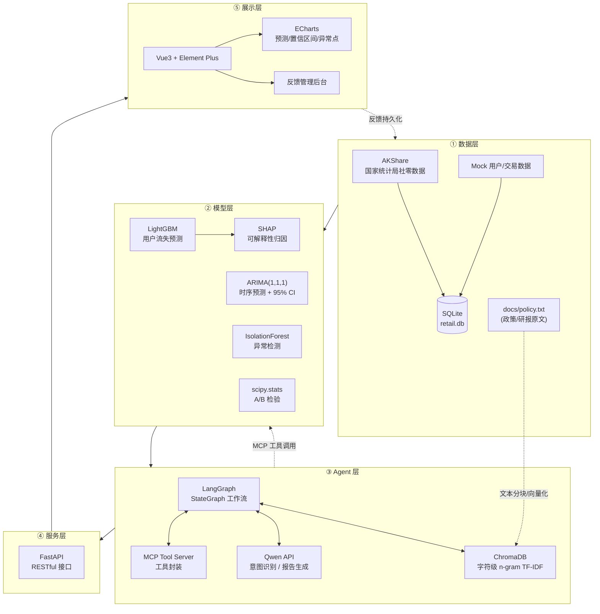

# Retail-Macro-Forecast-AI

### 零售消费品智能洞察中台 · Retail & Macro Intelligence Platform

> 从 R 语言毕业论文，到企业级 Python + AI Agent 数据洞察系统。
> 一站式覆盖 **宏观数据采集 → 特征工程 → 用户流失预测 → 时间序列预测 → 异常检测 → A/B 测试 → RAG 知识库 → Text-to-SQL → AI Agent 智能路由 → 可解释性执行明细 → 用户反馈闭环 → 前端数据看板**。

<p align="center">
  
  
  
  
  
  
  
  
  
</p>

---

## 📖 目录

- [1. 项目简介](#1-项目简介)
- [2. 核心亮点](#2-核心亮点)
- [3. 系统架构](#3-系统架构)
- [4. 功能矩阵](#4-功能矩阵)
- [5. 技能清单（MCP Tools）](#5-技能清单mcp-tools)
- [6. 快速启动指南](#6-快速启动指南)
- [7. API 接口一览](#7-api-接口一览)
- [8. 项目结构](#8-项目结构)
- [9. 面试 / 业务价值说明](#9-面试--业务价值说明)

---

## 1. 项目简介

**Retail-Macro-Forecast-AI** 是一个面向零售消费行业的 **端到端数据智能平台**，将「宏观经济研判」与「微观用户运营」统一到一个系统中：

- **宏观侧**：通过 AKShare 自动采集国家统计局「社会消费品零售总额」数据，用 ARIMA 做未来 3 个月预测，用 IsolationForest 识别异常月份。
- **微观侧**：基于 RFM 特征构建 LightGBM 用户流失预测模型，并用 SHAP 解释「为什么这个用户会流失」。
- **智能侧**：以 LangGraph 编排 AI Agent，通过 MCP 协议将模型能力工具化，接入 Qwen 大模型完成意图识别、工具路由与自然语言报告生成。内置基于 ChromaDB 的本地向量检索，支持真实的企业政策/研报 RAG 检索。
- **展示侧**：Vue3 + Element Plus + ECharts 打造现代化数据看板，支持预测置信区间可视化、异常点标注、回测指标展示，以及 Agent 执行明细（SQL/RAG原文）的完全可解释性。
- **闭环侧**：支持用户对 AI 生成报告的点赞/点踩反馈，并配套「报告反馈管理」后台，进行分页查询、筛选与点赞率统计，为 Prompt 迭代提供数据支撑。

系统设计遵循 **「数据采集 → 特征工程 → 模型训练 → 服务化 → Agent 编排 → 可解释性 → 业务反馈闭环 → 可视化」** 的完整工业级链路。

> **⚠️ 数据口径声明**：宏观数据来自公开统计源（国家统计局）；微观用户交易数据为基于 RFM 规则生成的模拟数据，不代表真实企业客户或真实消费者。演示结果用于验证分析流程，不应直接作为真实经营决策依据。

---

## 2. 核心亮点

### 2.1 数据口径透明化（业务合规）
- 宏观数据全部来自**国家统计局真实数据**（AKShare 采集）。
- 微观用户数据基于**真实 RFM 模型**与 **30% 自然流失率**模拟生成。
- 前端显式标注数据来源，避免“以假乱真”。

### 2.2 真实 RAG（中文检索工程落地）
- **ChromaDB** 本地持久化向量库，无需重型 Embedding 模型。
- 针对中文场景，采用 **字符级 n-gram (2,3) TF-IDF** 分词方案，离线可用、无额外依赖。
- 解决向量维度冲突（先删后建），并对未命中场景明确返回「未在知识库中找到相关研报」，拒绝编造。

### 2.3 可解释性与防幻觉（企业级 AI 必备）
- 强制大模型输出三段式结构：【SQL查询结果】、【知识库引用】、【执行摘要】。
- System Prompt 中严格约束：**不得自行编造数据，缺失数据必须输出“暂无数据”**。
- 前端提供 **「查看执行明细」** 折叠面板，可追溯原始 SQL、数据量、ChromaDB 原文片段，彻底打破黑盒。

### 2.4 生产级异常降级（稳定性保障）
- 所有 MCP 工具与 API 均实现 `try/except` 降级。
- 大模型调用失败时，自动切换至模板兜底报告，并在前端显式标注 **「AI 服务降级」** 状态。
- 后端返回 `generation_status`（success/fallback/failed），杜绝“假成功”。

### 2.5 完整业务闭环（从预测到行动）
- 用户流失预警支持风险等级筛选、跟进状态流转、批量生成召回计划。
- AI 报告支持导出 PDF 与用户反馈（点赞/点踩），并配套反馈管理后台。
- 反馈数据持久化至 SQLite，可统计整体点赞率，为 Prompt 优化提供数据依据。

### 2.6 工程严谨性（测试隔离与幂等）
- 使用 **临时 SQLite 数据库** 进行单元测试，避免污染真实 `retail.db`。
- 数据库表采用 `CREATE TABLE IF NOT EXISTS` 幂等建表。
- 边界测试覆盖：空库除零保护、非法参数 400、分页参数上限 422、重复初始化不清空数据。

---

## 3. 系统架构



---

## 4. 功能矩阵

| 功能模块 | 技术实现 | 关键输出 |
|---------|---------|---------|
| 宏观数据采集 | AKShare + SQLAlchemy | 2008-01 ~ 至今月度社零数据 |
| 特征工程 | Pandas + 类别编码 | RFM 特征、城市等级 one-hot |
| 用户流失预测 | LightGBM + 类别不平衡处理 | 流失概率、AUC / F1 / KS |
| 可解释性 | SHAP TreeExplainer | 特征归因、重要性排序 |
| 时间序列预测 | statsmodels ARIMA(1,1,1) | 未来 3 个月预测 + 95% 置信区间 |
| 历史回测 | 滚动窗口评估 | MAE / RMSE / MAPE |
| 异常检测 | sklearn IsolationForest | 异常月份标记（疫情/封控/危机） |
| A/B 测试 | scipy Levene + t 检验 | Uplift、显著性结论 |
| RAG 知识库 | ChromaDB + 字符级 n-gram | 政策/研报语义检索、未命中明确提示 |
| AI Agent | LangGraph + MCP + Qwen | 意图路由 + 结构化报告 + 执行明细 |
| 反馈闭环 | SQLite + FastAPI + Vue3 | 点赞/点踩持久化、点赞率统计、分页管理 |
| 前端看板 | Vue3 + Element Plus + ECharts | 预测置信区间图、异常散点、执行明细面板 |

---

## 5. 技能清单（MCP Tools）

系统将底层模型能力封装为 **MCP（Model Context Protocol）工具**，供 AI Agent 动态调用：

| 工具方法 | 能力 | 输入 | 输出 |
|---------|------|------|------|
| `query_macro_sqlite()` | 宏观社零数据查询 | — | 最新 3 期社零额与同比增速 |
| `predict_churn_lightgbm()` | 用户流失预测 | RFM + 城市等级特征 | 流失概率 |
| `forecast_timeseries()` | 时序预测 | — | 未来 3 个月预测 + 置信区间 + MAPE |
| `evaluate_ab_test(control, treatment)` | A/B 检验 | 两组样本 | Levene + t 检验 + Uplift 报告 |
| `rag_search(query)` | 知识库检索 | 自然语言问题 | 政策/研报真实片段 |

> 所有工具均实现 **异常捕获与优雅降级**：模型或依赖不可用时返回可读的错误信息，而非进程崩溃，保障 Agent 主链路稳定。

---

## 6. 快速启动指南

### 6.1 环境准备

```bash
# 1. 创建并激活虚拟环境（推荐 Python 3.10）
conda create -n retail_env python=3.10 -y
conda activate retail_env

# 2. 安装后端依赖
pip install -r requirements.txt
```

### 6.2 配置环境变量

在项目根目录创建 `.env`（已包含在 `.gitignore` 中，不会提交到仓库）：

```ini
DASHSCOPE_API_KEY=sk-xxxxxxxxxxxxxxxx
QWEN_MODEL=qwen3.7-flash
API_BASE_URL=http://127.0.0.1:8003
```

### 6.3 启动后端（FastAPI）

```bash
# 在项目根目录执行
uvicorn src.api.main:app --host 127.0.0.1 --port 8003 --reload
```

启动成功后访问：

- Swagger 文档：<http://127.0.0.1:8003/docs>
- 健康检查：<http://127.0.0.1:8003/health>

### 6.4 启动前端（Vue3）

```bash
cd retail-frontend
npm install          # 首次运行
npm run dev          # 开发模式，默认 http://localhost:5173
```

打开浏览器访问前端页面，可查看「数据总览」、「用户流失预警」、「智能问数 Agent」与「报告反馈管理」四大模块。

---

## 7. API 接口一览

| 方法 | 路径 | 说明 |
|------|------|------|
| `GET` | `/` | 服务欢迎信息 |
| `GET` | `/health` | 健康检查 |
| `POST` | `/api/v1/analyze` | 自然语言问数（AI Agent 诊断报告，限流 5/min/IP） |
| `GET` | `/api/v1/forecast` | 社零总额 ARIMA 预测（供前端 ECharts 使用） |
| `POST` | `/api/v1/feedback` | 提交用户反馈（up/down），持久化至 SQLite |
| `GET` | `/api/v1/feedback` | 分页查询反馈记录（支持筛选） |
| `GET` | `/api/v1/feedback/stats` | 反馈统计（总数/点赞/点踩/点赞率） |

`/api/v1/forecast` 响应示例（节选）：

```json
{
  "historical_dates": ["2008-01", "2008-02", "..."],
  "historical_values": [9077.3, 8354.7, "..."],
  "forecast_dates": ["2026-09", "2026-10", "2026-11"],
  "forecast_values": [40233.6, 40448.8, 40562.0],
  "lower_bound": [35956.6, 35213.0, 34819.2],
  "upper_bound": [44510.6, 45684.7, 46304.9],
  "metrics": { "mae": 1752.75, "rmse": 1792.03, "mape": 4.36 },
  "anomalies": [
    { "date": "2020-03", "value": 26449.9 },
    { "date": "2022-04", "value": 29483.1 }
  ]
}
```

`/api/v1/feedback/stats` 响应示例：

```json
{
  "status": "ok",
  "message": "查询成功",
  "data": { "total": 3, "up_count": 2, "down_count": 1, "up_rate": 0.6667 }
}
```

---

## 8. 项目结构

```
retail_insight_platform/
├── src/
│   ├── data_pipeline/              # 数据采集与 Mock 数据生成
│   │   ├── fetch_macro.py          # AKShare 采集宏观社零数据
│   │   └── generate_mock_data.py   # RFM 用户行为模拟
│   ├── models/                     # 模型训练与推理
│   │   ├── train_lgbm_churn.py     # LightGBM 流失预测 + SHAP
│   │   └── train_timeseries.py     # ARIMA 预测 + 异常检测 + 回测
│   ├── agents/                     # AI Agent 编排
│   │   ├── tools.py                # MCP 工具封装
│   │   └── graph_workflow.py       # LangGraph 工作流
│   └── api/
│       └── main.py                 # FastAPI 接口
├── docs/
│   └── policy.txt                  # RAG 知识库原文（政策/研报）
├── retail-frontend/                # Vue3 前端
│   └── src/App.vue                 # 数据总览 / 流失预警 / 智能问数 / 反馈管理
├── retail.db                       # SQLite 数据库（运行时生成）
├── chroma_db/                      # ChromaDB 向量库（运行时生成）
├── requirements.txt
└── .env                            # 环境变量（不入库）
```

---

## 9. 面试 / 业务价值说明

### 9.1 数据口径：为什么用「同比增长率」做异常检测
> **问题**：直接对 18 年社零原始值做异常检测，会被长期上涨趋势主导，误把 2008~2009 年的低基数期判为异常（42% 误判率）。
> **决策**：改用 `yoy_growth`（同比增速）作为检测特征。同比是同月对比，天然消除了趋势与季节性，能将检测聚焦在「偏离正常增速」的真实异常上。最终精准命中 2020 疫情暴跌、2022 封控、2008 金融危机等 10 个异常月份。

**面试亮点**：这体现了「特征选择服务于业务语义」的建模思维，而非机械套用算法。

### 9.2 成本权衡：ARIMA vs 复杂模型

| 维度 | ARIMA(1,1,1) | LSTM / Prophet |
|------|-------------|----------------|
| 训练成本 | 毫秒级，单机即可 | 需要 GPU / 较长时间 |
| 可解释性 | 参数透明，置信区间解析解 | 黑盒，区间需近似 |
| 数据需求 | 数十个样本即可 | 需要大量样本 |
| 适用场景 | 宏观月度数据、少样本 | 高频、复杂非线性 |


### 9.3 RAG 工程落地：轻量中文检索方案
> **问题 1**：`TfidfVectorizer` 默认按空格分词，对中文无效（相似度全为 0）。
> **决策 1**：采用**字符级 n-gram（2,3）**，无需引入 `jieba` 等额外依赖，离线可用。
> **问题 2**：语料/分词变化导致 ChromaDB 向量维度不一致。
> **决策 2**：每次调用采用「先删后建」写入集合，彻底避免维度冲突。

**面试亮点**：这不是简单的“调包”，而是针对中文场景和本地化部署的深度工程权衡。

### 9.4 优雅降级：AI 系统的稳定性保障
> 所有 MCP 工具与 API 均实现 `try/except` 降级。当大模型 API、模型文件或数据库不可用时，系统返回可读的降级信息，保证业务主链路不因单点故障而崩溃。

**面试亮点**：这是「Demo 脚本」与「企业级系统」的分水岭——工程化思维体现在对异常路径的处理上。

### 9.5 业务闭环：从「模型」到「行动」
传统系统把模型能力写死在接口里；本系统通过 **MCP 协议** 将模型能力标准化为工具，由 **LangGraph + Qwen** 动态理解用户意图并路由到对应工具。同时，前端提供 **「查看执行明细」** 面板，可追溯 SQL 语句和 RAG 原文，彻底消除大模型的“黑盒感”。此外，**用户反馈闭环**（点赞/点踩 + 管理后台）为后续 Prompt 优化提供了真实数据支撑。

---

## 10. 当前限制与后续迭代方向

本项目定位为可运行、可演示的 AI 应用作品，不等同于已通过生产验收的企业系统。以下边界在面试中应如实说明：

- **RAG**：使用字符级 TF-IDF，而非稠密语义 Embedding；对同义改写和复杂语义的召回能力有限。
- **向量库**：若每次调用都重建 ChromaDB 集合，适合小规模演示，不适合大语料高并发。生产环境应将文档解析、向量化和入库作为独立的离线/增量任务。
- **反馈闭环**：当前已实现持久化落库与管理页查询；但批量召回计划仍为前端交互演示，未在真实后端创建任务或向用户发送营销信息。
- **报告导出**：使用浏览器 `window.print()`，不是由服务端生成和存档 PDF。
- **限流**：单机内存限流（5/min/IP）不适合多实例生产环境，后续应迁移到 Redis 共享存储。
- **数据依赖性**：预测误差和异常识别效果依赖数据快照、训练/测试划分、参数和评估方法；需在固定条件下复现实验后再用于对外汇报。
- **访问控制**：当前演示后台未包含完整的生产级认证、授权与审计机制，对外部署前需补充。
