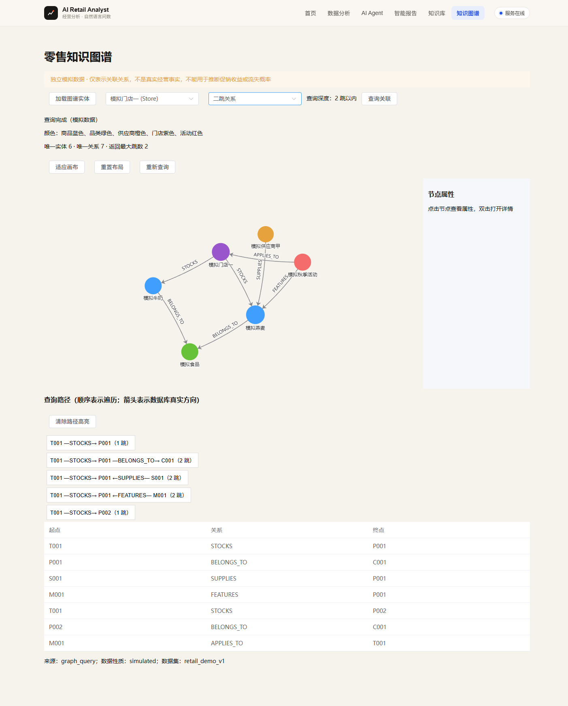
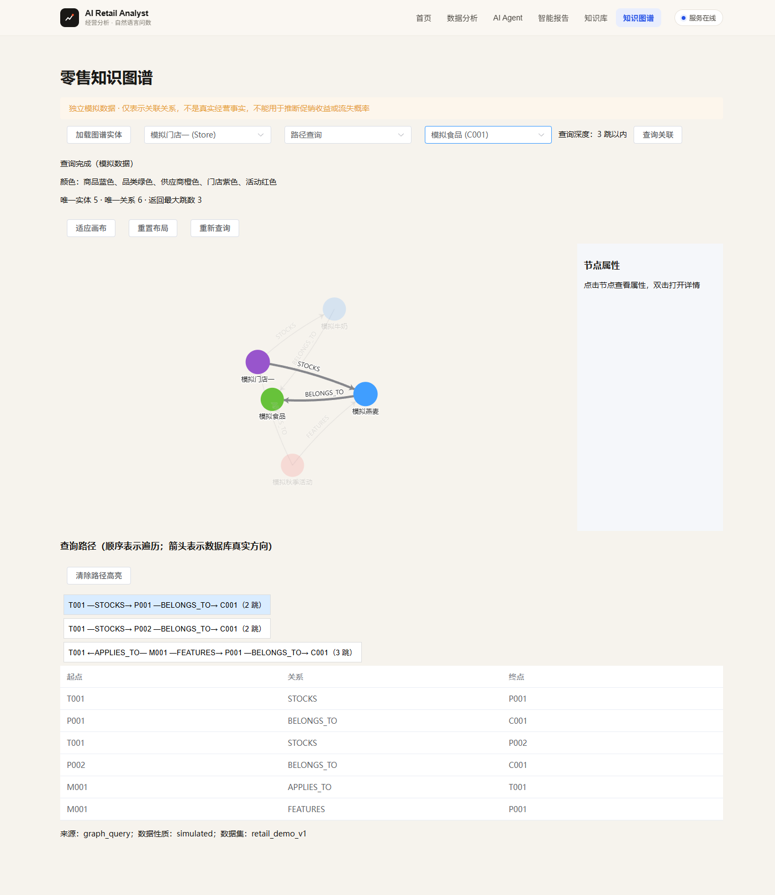
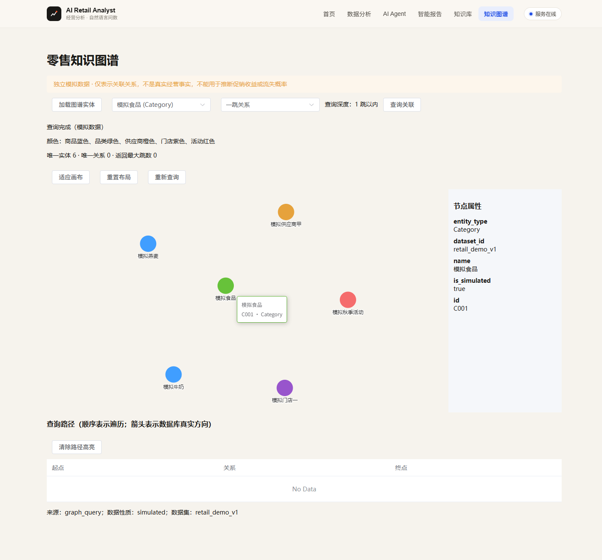
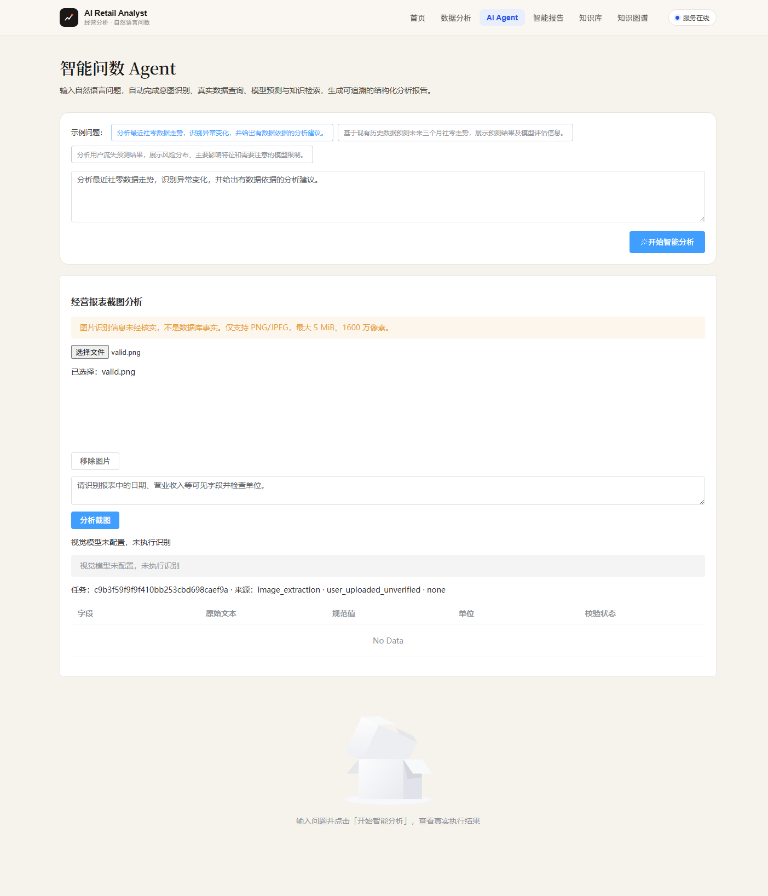

# 2026-11-01 精选验收证据

这些是历史实测记录，不表示整理阶段重新跑过验收。

- [最终报告](acceptance_report.md)
- [完整回归：144通过、1跳过](full_regression_summary.json) / [原始记录](full_regression.txt)
- [真实图谱HTTP：6项通过](live_http_summary.json) / [请求和响应](live_http_evidence.json)
- [多模态HTTP：7项检查](multimodal_http.json)
- [构建记录](build.txt) / [退出码](build_exit.txt)
- [浏览器Network](final-browser/browser_network.json) / [Console](final-browser/browser_console.json)
- [节点交互](interactions/checks.json) / [Console](interactions/browser_console.json)
- [断网恢复](recovery/checks.json) / [预期网络错误](recovery/browser_console.json)
- [来源与校验和](manifest.json)

原始artifacts保留在本机，不纳入Git；本归档不包含Chrome用户配置、Cookie、数据库、缓存、图片上传原件或密钥。
